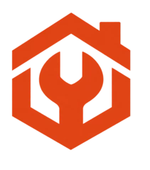

<p align="center">
  
</p>

<h1 align="center">Ferretería El Tornillo</h1>

<p align="center">
  Catálogo online con CRUD web, reportes con ORM, formulario de clientes y sesiones<br>
  Evaluación Sumativa 3 · Programación Back End (TI3041)
</p>

---

Proyecto desarrollado con Django para la Evaluación Sumativa 3 de Programación Back End. Corresponde a la variante A de la pauta: un catálogo online para una ferretería con 40 productos (nombre, categoría, precio y stock).

El proyecto parte del código de la Evaluación Sumativa 2. En esta evaluación el negocio gestiona su catálogo directamente desde el sitio, obtiene reportes calculados con el ORM y recibe consultas de sus clientes guardadas en la base de datos.

## Novedades de la ES3 por etapa

### Etapa 0: entorno

- Repositorio nuevo con el proyecto de la ES2 funcionando, la base de datos migrada y los 40 productos cargados desde la fixture.

### Etapa 1: CRUD del catálogo desde la web

- Crear, editar y eliminar productos desde `/gestion/`, sin usar `/admin`.
- El formulario `ProductoForm` es un `ModelForm` del modelo `Producto`, con validaciones (precio mayor a $0, descripción obligatoria y foto JPG, PNG o WebP de hasta 5 MB).
- Eliminar pide confirmación en una página propia y solo borra con POST.
- Después de cada operación se vuelve al listado de gestión, que lee los productos desde la base de datos.
- Ajuste rápido de stock con botones − y + en la tabla, sin dejar el stock en negativo.

### Etapa 2: reportes con ORM

- **Reporte 1, resumen por categoría** (`/gestion/reportes/categorias/`): cantidad de productos, agotados, unidades en stock, precio promedio, rango de precios y valor del inventario por categoría, con `values()` + `annotate()`. Los totales del catálogo salen de `aggregate()`.
- Además muestra la distribución del stock en cuatro niveles (`Count` con `filter=Q(...)`) y los 5 productos con más dinero en bodega (`annotate(F("precio") * F("stock"))` + `order_by`).
- **Reporte 2, stock crítico** (`/gestion/reportes/stock-critico/`): productos con stock igual o menor a un umbral (10 por defecto, se puede cambiar), usando `filter()` y `order_by()`, con filtro opcional por categoría.
- Todos los cálculos se hacen en la vista con el ORM; los templates solo muestran los valores.
- Los dos reportes se descargan en Excel (`.xlsx`) con `openpyxl`.
- Los reportes se abren desde el menú «Mi cuenta» de la cabecera de `base.html` y desde las pestañas de gestión.

### Etapa 3: clientes, sesiones y seguridad

- **Modelo `ConsultaCliente`** (nombre, correo, mensaje, producto de interés opcional y fecha automática), registrado en `/admin`.
- **Formulario de consultas** (`/consultas/`) hecho con `ModelForm`: campos obligatorios, correo válido y largo mínimo (nombre de 3 letras y mensaje de 10 caracteres). La vista guarda la consulta en la base de datos y muestra una página de confirmación.
- **Sesiones:** la ficha de cada producto guarda en `request.session` los últimos 3 productos visitados; se muestran en la ficha y en «Mi cuenta».
- **Seguridad:** todos los formularios llevan `` y las acciones que cambian datos solo aceptan POST. Las pruebas revisan que un envío sin token sea rechazado y que los datos inválidos muestren mensajes claros.
- **Pedidos en la base de datos:** los pedidos pasan del archivo JSON a los modelos `Pedido` y `DetallePedido`, con estados (Recibido, En preparación, Listo para retiro, Entregado y Cancelado).
- **Para el cliente:** rastreo del pedido, cancelación mientras está «Recibido» (el stock vuelve a la tienda), «Mis consultas» con la respuesta de la tienda, edición de sus datos (`PerfilCliente`) y suscripción a ofertas.
- **Para el administrador:** cambio de estado de los pedidos, bandeja de consultas para responder, reporte de ventas (más vendidos, ingresos por categoría y pedidos por estado) y lista de suscriptores, todo con descarga en Excel donde corresponde.

### Etapa 4: entrega

- Documento de uso de IA (`uso_ia.md`) en la raíz del repositorio.
- README actualizado y verificación del repositorio desde un clon limpio.

## Instalación

Se necesita Python 3 y `pip`.

En Linux o macOS:

```bash
python3 -m venv venv
source venv/bin/activate
python -m pip install -r requirements.txt
python manage.py migrate
python manage.py loaddata productos
python manage.py createsuperuser
python manage.py runserver
```

En Windows:

```bash
py -m venv venv
venv\Scripts\activate
python -m pip install -r requirements.txt
python manage.py migrate
python manage.py loaddata productos
python manage.py createsuperuser
python manage.py runserver
```

Luego se puede abrir la tienda en <http://127.0.0.1:8000/> y el administrador de Django en <http://127.0.0.1:8000/admin/>.

El comando `loaddata productos` carga los 40 productos de la fixture en la base de datos. La base de datos (`db.sqlite3`) no se sube al repositorio, por eso hay que crear el superusuario con `createsuperuser` después de clonar. En un clon nuevo no hay pedidos ni consultas: aparecen al comprar o al enviar una consulta desde el sitio.

## Credenciales de prueba

| Tipo de cuenta | Usuario | Contraseña | Dónde ingresa |
| --- | --- | --- | --- |
| Superusuario (Django Admin) | `superadmin` | `SuperAdminTornillo2026!` | <http://127.0.0.1:8000/admin/> |
| Administrador de la tienda | `admin` | `AdminTornillo2026!` | <http://127.0.0.1:8000/cuenta/ingresar/> |
| Cliente | `cliente` | `ClienteTornillo2026!` | <http://127.0.0.1:8000/cuenta/ingresar/> |

Las cuentas de la tienda (`admin` y `cliente`) vienen de la ES1 y están guardadas en `data/usuarios.json`. El superusuario se crea con `createsuperuser` usando esos datos.

## Rutas principales

Tienda y clientes:

- `/`: portada de la ferretería.
- `/catalogo/`: catálogo de productos leído desde la base de datos.
- `/producto/<id>/`: detalle de un producto (guarda el producto en «vistos recientemente»).
- `/carrito/` y `/compra/`: carrito y confirmación del pedido.
- `/pedido/<código>/`: detalle y rastreo de un pedido.
- `/consultas/`: formulario de consultas de clientes.
- `/cuenta/`: «Mi cuenta» con pedidos, consultas, datos, ofertas y vistos recientemente.
- `/cuenta/mis-datos/`: datos del cliente (bloqueados hasta presionar «Editar mis datos»).
- `/cuenta/ingresar/` y `/cuenta/registro/`: ingreso y registro.

Administración de la tienda (cuenta `admin`, desde el menú «Mi cuenta»):

- `/gestion/`: CRUD de productos y ajuste de stock.
- `/gestion/pedidos/`: pedidos con filtro y cambio de estado.
- `/gestion/consultas/`: bandeja de consultas para responder.
- `/gestion/reportes/categorias/`: reporte 1, resumen por categoría.
- `/gestion/reportes/stock-critico/`: reporte 2, stock crítico.
- `/gestion/reportes/ventas/`: reporte de ventas.
- `/gestion/suscriptores/`: suscriptores a las ofertas.
- `/admin/`: Django Admin con todos los modelos registrados.

## Archivos principales

- `catalogo/models.py`: modelos `Producto`, `Pedido`, `DetallePedido`, `ConsultaCliente`, `PerfilCliente` y `Suscripcion`.
- `catalogo/forms.py`: formularios, entre ellos `ProductoForm` y `ConsultaForm` (`ModelForm`).
- `catalogo/views.py`: vistas, consultas del ORM de los reportes y uso de la sesión.
- `catalogo/excel.py`: arma los archivos Excel de los reportes (solo da formato; los datos vienen de la vista).
- `catalogo/admin.py`: configuración de los modelos en Django Admin.
- `catalogo/urls.py`: rutas de la tienda y de la gestión.
- `catalogo/migrations/`: migraciones de los modelos.
- `catalogo/fixtures/productos.json`: poblamiento inicial de 40 productos.
- `catalogo/backends.py` y `catalogo/usuarios.py`: login de la tienda con `data/usuarios.json`.
- `catalogo/tests.py`: pruebas automáticas del sitio.
- `catalogo/templates/`: templates del sitio.
- `catalogo/static/catalogo/`: estilos, JavaScript e imágenes.
- `config/settings.py`: configuración del proyecto y de la base de datos.
- `uso_ia.md`: registro del uso de IA durante la evaluación.

## Comprobación

Con el entorno virtual activado:

```bash
python manage.py check
python manage.py test
```

Las compras son solo una demostración académica: no se realizan pagos, envíos ni correos reales.
